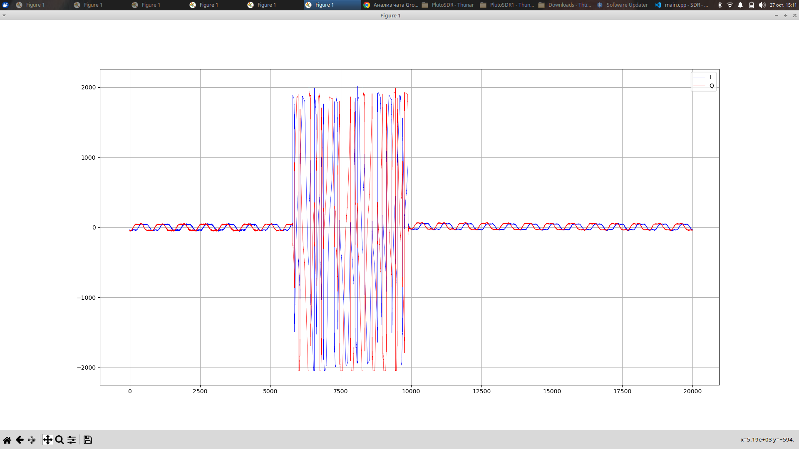
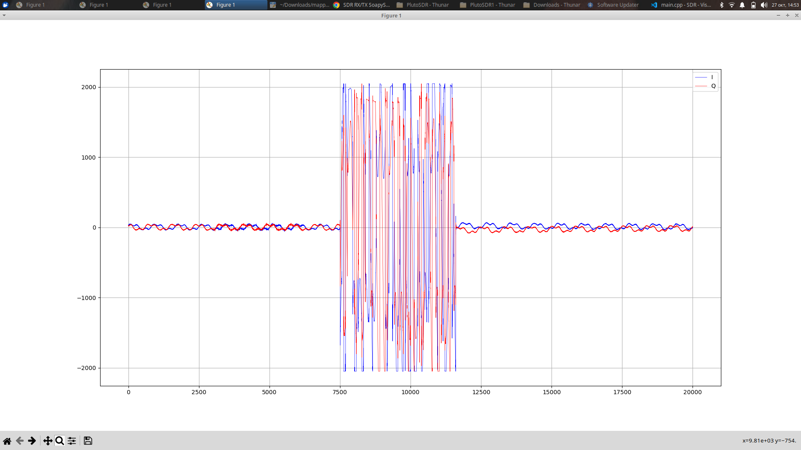
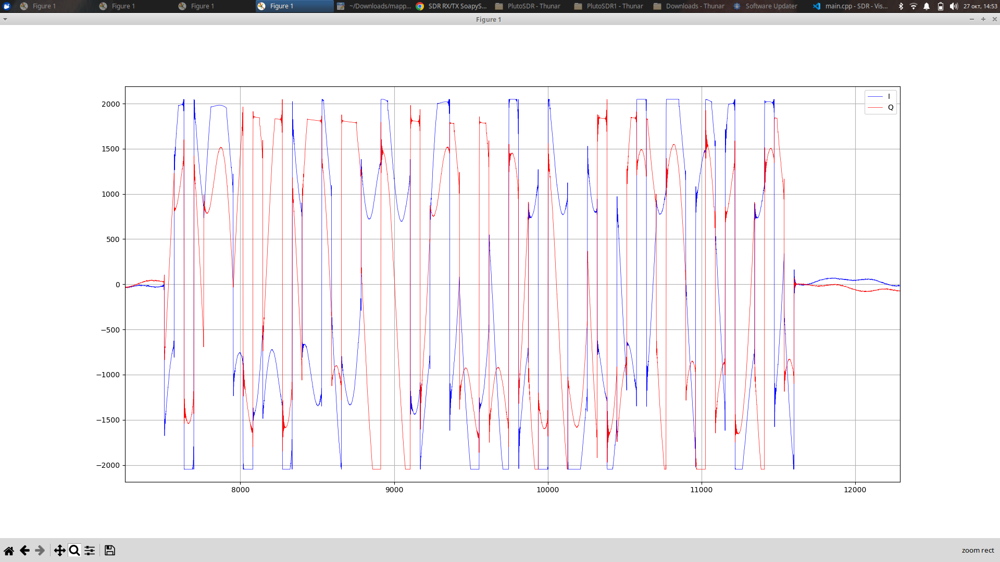

# Отчёт по практической работе

**Студент:** Попова В.П.  
**Группа:** ИКС-433  
**Дата выполнения:** 27.10.2026  

---

## Практика 6

### 1. Цель работы

Цель практической работы - реализовать функции формирования цифрового сигнала, включающие генерацию битов, BPSK- и QPSK-модуляцию, передискретизацию и формирование прямоугольных импульсов, подключить их к основной программе и организовать работу с двумя SDR-устройствами.

### 2. Реализация функций обработки сигнала

Для реализации алгоритмов обработки сигнала создан заголовочный файл `transmitter.h`. В нём определена структура `Complex`, которая хранит действительную (`I`) и мнимую (`Q`) составляющие комплексного отсчёта.

#### 2.1. Генерация битов

Функция `generate_bits()` создаёт последовательность случайных битов со значениями `0` и `1`. Полученная последовательность используется в качестве исходных данных для дальнейшей модуляции.

#### 2.2. BPSK-модуляция

Функция `bpsk()` преобразует каждый входной бит в один комплексный символ. Для одного значения бита устанавливается действительная компонента `I = +1`, для другого — `I = -1`. Квадратурная компонента в обоих случаях равна нулю (`Q = 0`).

Таким образом, BPSK использует два возможных состояния сигнала, расположенных на действительной оси комплексной плоскости.

#### 2.3. QPSK-модуляция

Функция `qpsk()` объединяет входные биты в пары и преобразует каждую пару в один комплексный символ. Первый бит задаёт знак компоненты `I`, второй — знак компоненты `Q`. Следовательно, один символ QPSK представляет два бита.

В основной программе для формирования передаваемого сигнала используется BPSK-модуляция. Функция QPSK реализована в модуле, но в представленном коде не вызывается.

### 3. Передискретизация и формирование прямоугольных импульсов

В модуле предусмотрены функции `upsample()` и `rectangular()`, выполняющие разные операции.

#### 3.1. Передискретизация (`upsample`)

Функция `upsample()` увеличивает число отсчётов в `L` раз. Исходные символы размещаются через `L` позиций, а промежуточные позиции заполняются нулевыми отсчётами.

#### 3.2. Формирование прямоугольных импульсов (`rectangular`)

Функция `rectangular()` копирует каждый символ в выходной массив `L` раз подряд. В результате значение символа сохраняется на протяжении заданного числа отсчётов, формируя прямоугольный импульс.

В основной программе используется функция `rectangular()`. Коэффициент `L` равен `64`, поэтому каждый символ представлен 64 одинаковыми комплексными отсчётами.

### 4. Подключение модуля к основной программе

Модуль подключается к основной программе директивой:

```c
#include "transmitter.h"
```

В режиме передачи выполняются следующие основные шаги:

1. Определяются размеры массивов битов, символов и отсчётов.
2. Выделяется память для буферов данных.
3. Функция `generate_bits()` создаёт случайную битовую последовательность.
4. Функция `bpsk()` преобразует биты в BPSK-символы.
5. Функция `rectangular()` формирует прямоугольные импульсы.
6. Комплексные отсчёты масштабируются и преобразуются в 16-битный целочисленный формат.
7. Сформированный буфер передаётся с помощью `SoapySDRDevice_writeStream()`.

Для передачи используется коэффициент масштабирования `20000` для компоненты `I`. В BPSK квадратурная компонента `Q` равна нулю. Данные подготавливаются в формате CS16, в котором для каждого комплексного отсчёта последовательно записываются компоненты I и Q.

### 5. Настройка и работа с SDR-устройствами

Для управления радиоустройствами используется библиотека SoapySDR и драйвер `plutosdr`. Программа принимает три аргумента командной строки:

- идентификатор устройства - `sdr1` или `sdr2`;
- режим работы - `rx` или `tx`;
- URI устройства.

В программе заданы следующие параметры:

| Параметр | Значение |
|---|---:|
| Частота дискретизации | 1 МГц |
| RX-частота SDR1 | 790 МГц |
| TX-частота SDR1 | 700 МГц |
| RX-частота SDR2 | 700 МГц |
| TX-частота SDR2 | 790 МГц |
| Усиление приёмника | 50 |
| Усиление передатчика | 40 |
| Максимальное число обработанных буферов | 200 |
| Коэффициент `L` | 64 |

Программа настраивает частоту дискретизации, частоты приёма и передачи, а также усиление. Затем создаёт и активирует поток приёма. В режиме передачи дополнительно создаётся поток TX.

В режиме `RX` принятые данные записываются в файл `sdr1_rxdata.pcm` или `sdr2_rxdata.pcm` в зависимости от выбранного устройства. В режиме `TX` программа формирует BPSK-сигнал и отправляет его через поток передачи.

Частоты устройств настроены попарно: SDR1 принимает на частоте 790 МГц и передаёт на 700 МГц, а SDR2 принимает на 700 МГц и передаёт на 790 МГц. Такая конфигурация позволяет настроить устройства для взаимной передачи и приёма на соответствующих частотах.

### 6. Порядок выполнения работы

1. Реализованы функции генерации случайных битов и BPSK/QPSK-модуляции.
2. Реализованы передискретизация с вставкой нулевых отсчётов и формирование прямоугольных импульсов.
3. Функции подключены к основной программе через `transmitter.h`.
4. В основном коде настроена цепочка формирования BPSK-сигнала: генерация битов, модуляция, прямоугольное формирование и преобразование отсчётов в формат CS16.
5. Настроены частота дискретизации, рабочие частоты и усиление двух SDR-устройств.
6. Реализованы режимы приёма и передачи, а также запись принятых отсчётов в PCM-файл.

### 7. Результаты работы

В программе реализована обработка цифровых данных и подготовка комплексного сигнала к передаче через SDR. Основная программа использует BPSK-модуляцию и формирование прямоугольных импульсов с коэффициентом `L = 64`.

Также предусмотрены настройка двух SDR-устройств на соответствующие частоты приёма и передачи, запуск потоков RX/TX и сохранение принятых данных в файл.

Успешность приёма сигнала и качество передачи должны оцениваться по фактическим результатам эксперимента. При необходимости в этот раздел можно добавить снимки консоли и другие подтверждения работы оборудования.

### 8. Визуализация сформированных сигналов

Для анализа результатов передачи сигнала были использованы данные, сохранённые SDR-приёмником в файл sdrn_rxdata.pcm. На основе извлечённых из файла данных были построены графики, позволяющие исследовать принятый сигнал и рассмотреть особенности BPSK- и QPSK-модуляции.


**Рисунок 1 — График принятого сигнала при BPSK-модуляции**

График построен на основе данных, извлечённых из файла приёма. Он используется для визуального анализа сигнала, переданного с применением BPSK-модуляции.


**Рисунок 2 — График принятого сигнала при QPSK-модуляции**

На графике представлено визуальное отображение данных, полученных из файла приёма при исследовании QPSK-сигнала. Он позволяет рассмотреть временную структуру принятого сигнала.


**Рисунок 3 — Увеличенный фрагмент принятого QPSK-сигнала**

Увеличенный фрагмент позволяет подробнее рассмотреть отдельный участок принятого сигнала и изменение его значений во времени.

Таким образом, данные, сохранённые в файле sdrn_rxdata.pcm, были использованы для построения графиков и визуального анализа принятых сигналов. Полученные графики дополняют проверку работы передающего и приёмного трактов SDR.